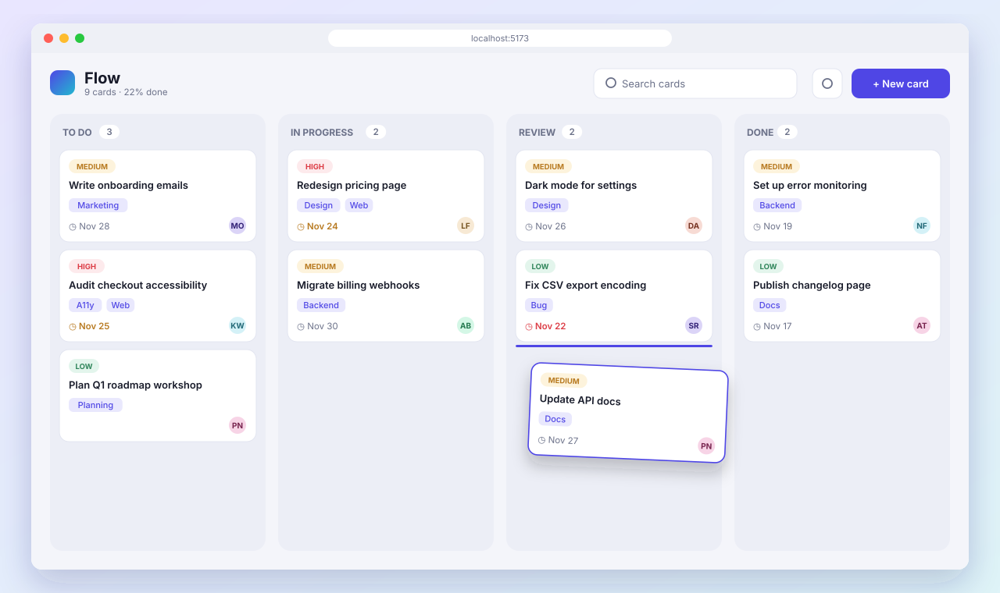

<p align="center">
  
</p>
<p align="center"><sub>Preview: design illustration of the board (light theme) while a card is dragged.</sub></p>

# Flow: React Kanban Board

A modern, free Kanban board template built with **React 18**, **TypeScript** and **Vite**. No UI library and no drag-and-drop library: native HTML5 drag and drop, a small readable codebase and logic you can copy into your own product.

## Features

- **Drag and drop** cards between columns and reorder them, with a drop indicator
- **Keyboard and touch friendly**: every card has move-left / move-right buttons, so nothing depends on dragging
- **Add, edit and delete** cards in an accessible native `<dialog>`
- **Priority, assignee, labels and due date**, with overdue and due-soon highlighting
- **Search** across title, description, assignee and labels
- **Progress** summary in the header
- **Saved in the browser** (localStorage), safe when storage is unavailable
- **Light and dark themes**, remembered between visits, no flash on load
- **Responsive**: columns scroll sideways with snapping on small screens
- **Zero dependencies** beyond React

## Quick start

```bash
git clone https://github.com/lenivalestevao/react-kanban-board.git
cd react-kanban-board
npm install
npm run dev
```

| Command | What it does |
| --- | --- |
| `npm run build` | Type-check and create a production build in `dist/` |
| `npm run preview` | Serve the production build locally |
| `npm test` | Run the unit tests (Vitest) |
| `npm run typecheck` | TypeScript check only |

## Project structure

```
src/
  App.tsx                 State (reducer), search, dialog and layout
  types.ts                Card, Board, columns and priorities
  styles.css              Design tokens (light and dark) and all styles
  components/
    Column.tsx            Drop zone, drop index and drop indicator
    CardView.tsx          Card UI and drag source
    CardDialog.tsx        Create / edit form
    ui.tsx                Icons, avatar, icon button
  lib/
    board.ts              Pure functions: move, add, update, delete, search, due dates, reducer
    board.test.ts         Unit tests
    storage.ts            Validated localStorage load / save
    theme.ts              Theme hook with persistence
  data/seed.ts            Demo cards (dates relative to today)
```

## Make it yours

- **Columns**: edit `COLUMNS` and the `ColumnId` type in `src/types.ts`, then the seed in `src/data/seed.ts`.
- **Colors**: change the CSS variables at the top of `src/styles.css`.
- **Backend**: `board.ts` is pure, so you can run the same reducer and sync the result to your API instead of localStorage.
- **Storage key**: `flow-board-v1` in `src/lib/storage.ts`. Bump it if you change the data shape.

## License

MIT. Free for personal and commercial use.
